# AI usage

**Codex와 Claude의 한도, 다음 초기화 시각, 최근 작업을 한눈에 보는 데스크톱 앱**

Mac에서는 메뉴 막대, Windows에서는 작업 표시줄의 알림 영역에 표시됩니다. 팝업으로 두 서비스 상태를 비교하거나, 바탕화면에 위젯을 띄워 작업하면서 확인할 수 있습니다.

**2.2.0 빌드 47** · macOS 13 이상 · Windows 11 x64 · 한국어 / English

[설치 파일](#다운로드) · [화면 미리보기](#화면-미리보기) · [설치](#설치) · [계정 연결](#계정-연결) · [사용법](#사용법) · [문제 해결](#문제-해결)

## 다운로드

| 환경 | 설치 파일 | 요구 사항 |
| --- | --- | --- |
| macOS | [DMG 다운로드][mac-dmg] · [ZIP 다운로드][mac-zip] | macOS 13 이상 · Apple Silicon / Intel 공용 |
| Windows | [x64 ZIP 다운로드][win-zip] | Windows 11 x64 · Claude 로그인에 WebView2 Runtime 필요 |

릴리스에 설치 파일, 각 파일의 SHA-256 체크섬, 라이선스가 있습니다. [AI usage 2.2.0 릴리스][release]

## 주요 기능

| 기능 | 할 수 있는 일 |
| --- | --- |
| 한도 요약 | Codex와 Claude의 5시간·주간 한도, 소진율·잔여량, 초기화까지 남은 시간 확인 |
| Claude 상세 | 5시간·7일 한도를 먼저 보고, 제공되는 모델별·추가 한도와 주간 사용 내역을 펼쳐 보기 |
| 팝업과 위젯 | 각 화면의 디자인과 막대형·원형 게이지를 별도로 설정 |
| 작업 목록 | Codex·Claude Code 작업 상태 확인, 지원되는 대화 열기, 목록에서 완료·중단 항목 정리 |
| 한도 알림 | 한도 임박과 초기화 알림 설정 |
| 펫과 추이 | Codex 펫 또는 내장 캐릭터 표시, 사용량 기록을 켜고 기간·서비스별 추이 보기 |
| 오늘 토큰 비용 | 이 기기의 로컬 토큰 기록을 표준 API 요율로 환산한 비용 추정치 확인 |

## 화면 미리보기

<table>
<tr><th>한도 팝업과 Claude 상세</th><th>Structural UI가 적용된 설정</th></tr>
<tr valign="top">
<td>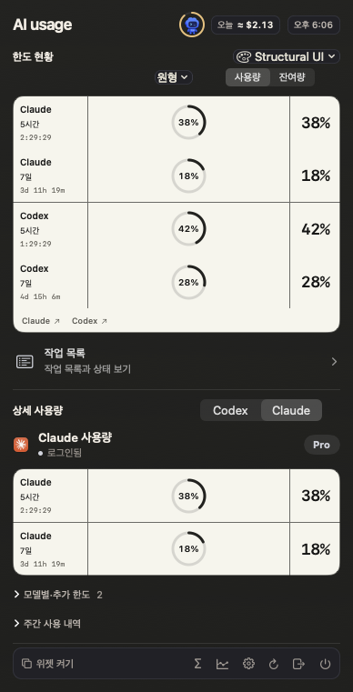</td>
<td>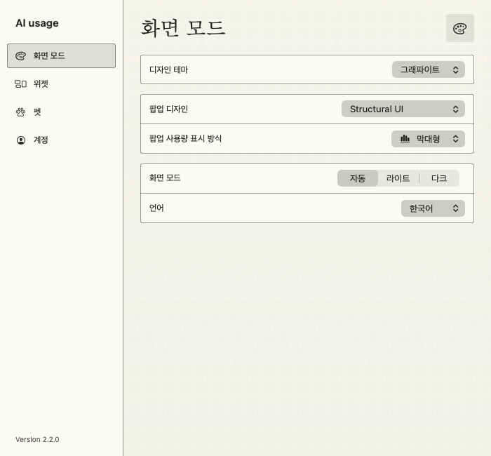</td>
</tr>
</table>

macOS 2.2.0 빌드 47의 데모 데이터입니다. 표시된 사용률과 비용은 예시입니다.

### 팝업 디자인 네 가지 비교

메뉴 막대에서 AI usage 아이콘을 누른 뒤 팝업 오른쪽 위의 **디자인 메뉴**에서 바꿉니다. 아래 네 화면은 같은 데모 사용량을 막대형으로 표시합니다. 화면 위쪽에서 **막대형·원형**과 **사용량·잔여량**을 선택합니다. 하단의 **Codex·Claude** 탭으로 서비스별 상세 화면을 엽니다.

<table>
<tr><th>Liquid Glass</th><th>Material 3 Expressive</th></tr>
<tr>
<td>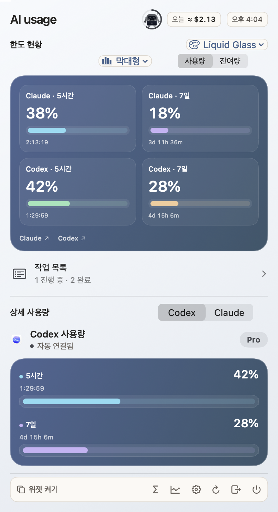</td>
<td>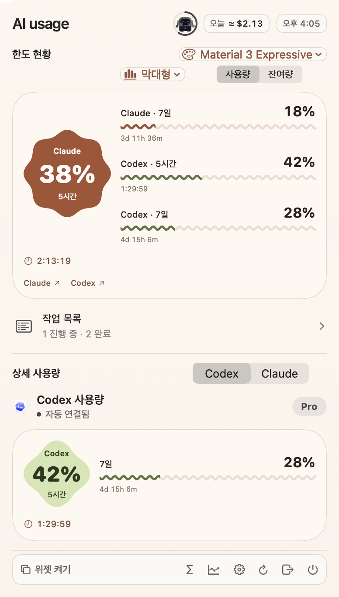</td>
</tr>
<tr><th>Bento Grid</th><th>Structural UI</th></tr>
<tr>
<td>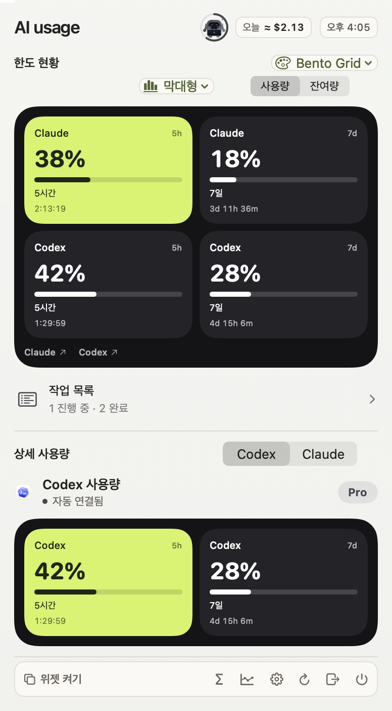</td>
<td>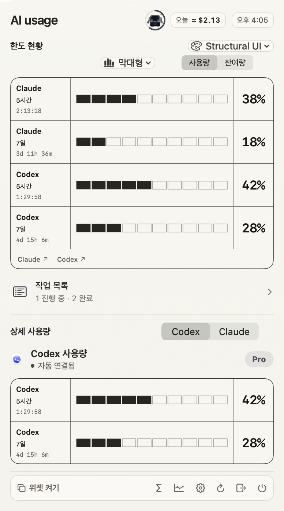</td>
</tr>
</table>

예시에서 Codex 5시간 사용량은 42%, 7일 사용량은 28%입니다. 각 한도 아래에서 초기화까지 남은 시간을 확인합니다. **잔여량**으로 바꾸면 5시간 한도의 예시 값이 58%로 바뀝니다.

### 작업 중심과 가로 위젯

<table>
<tr><th>작업 중심 · Bento Grid</th><th>가로 배치 · Liquid Glass</th></tr>
<tr>
<td>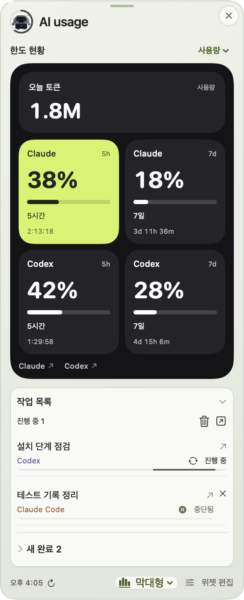</td>
<td>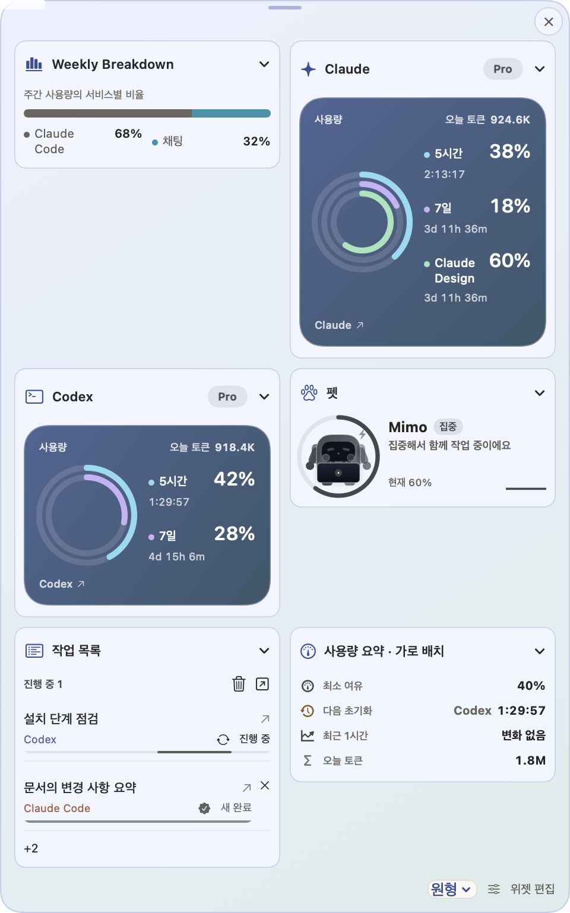</td>
</tr>
</table>

- **작업 중심**은 진행 중인 작업과 최근 작업을 작은 폭에 표시합니다. **가로** 배치는 선택한 항목을 두 열에 놓아 사용량과 작업을 함께 볼 수 있습니다.
- 팝업에서 **위젯 켜기**를 누릅니다. 위젯의 상단 손잡이를 드래그해 옮기고 **×**로 숨길 수 있습니다.

### 위젯 설정에서 표시 항목 바꾸기

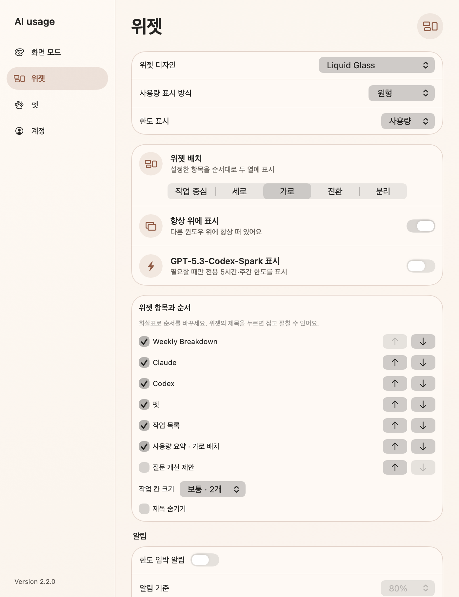

1. **설정 > 위젯**에서 위젯 디자인과 사용량 표시 방식을 고릅니다. 예시처럼 팝업은 막대형, 위젯은 원형으로 사용할 수 있습니다.
2. **위젯 배치**에서 작업 중심·세로·가로·전환·분리 중 하나를 고릅니다.
3. **위젯 항목과 순서**에서 체크박스로 항목을 켜고 끕니다. 오른쪽 **↑·↓** 버튼으로 순서를 바꾸고 **작업 칸 크기**에서 표시할 작업 수를 조절합니다.

### 작업 목록에서 대화 열기와 목록 정리

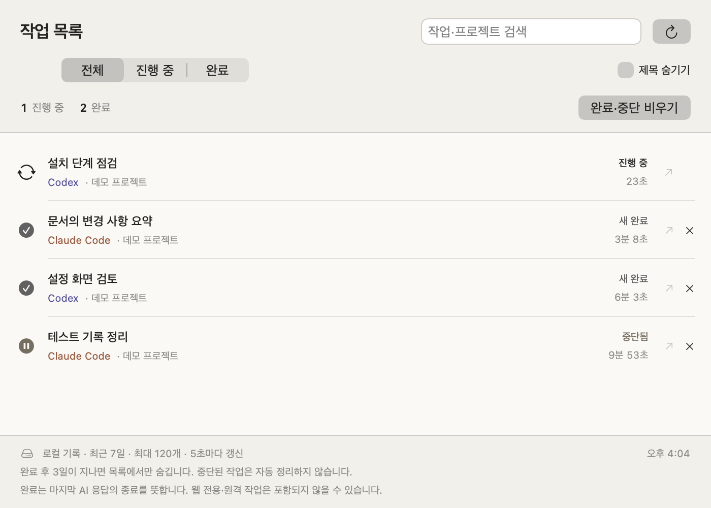

- 팝업의 **작업 목록**을 열고 **전체·진행 중·완료** 필터나 오른쪽 위의 작업·프로젝트 검색을 사용합니다. 주변에 작업 제목이 보이는 게 신경 쓰이면 **제목 숨기기**를 켭니다.
- 작업의 **↗** 버튼으로 지원되는 Codex·Claude Code 대화나 세션을 엽니다. 새로 끝난 작업을 열면 **새 완료** 표시가 해제됩니다.
- 항목 오른쪽 **×**로 하나씩 숨기거나 **완료·중단 비우기**로 한 번에 정리합니다. 완료된 지 3일이 지나면 목록에서 자동으로 숨겨지며 원본 대화는 보관됩니다. 중단된 작업은 수동으로 정리할 수 있습니다.

### 사용량 기록 그래프 읽기

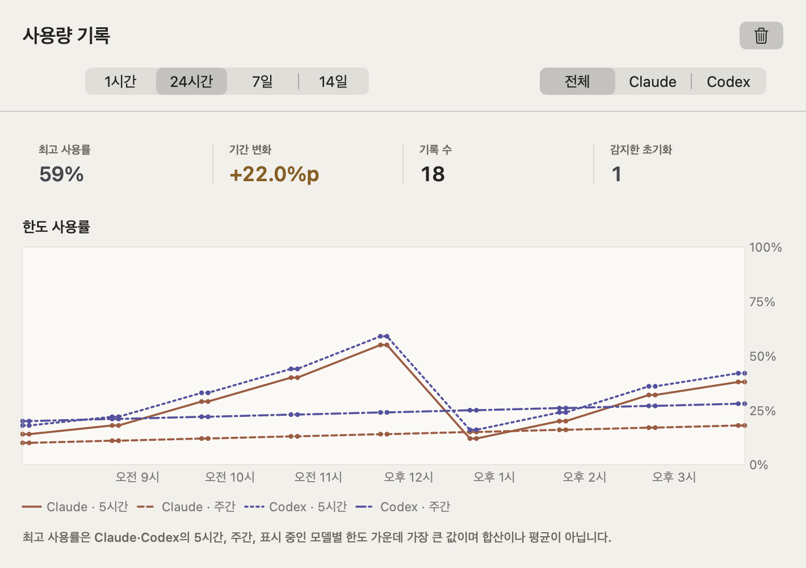

1. 설정에서 **사용량 추이 기록**을 켠 뒤 팝업 하단의 **그래프 버튼**을 누릅니다.
2. 위쪽에서 **1시간·24시간·7일·14일** 기간과 **전체·Claude·Codex** 중 볼 대상을 고릅니다.
3. 범례로 서비스와 5시간·주간 선을 구분합니다. 위쪽 **최고 사용률**은 선택 범위에서 표시된 한도 중 가장 높은 비율입니다. **기간 변화**는 퍼센트포인트로, **감지한 초기화**는 선택 범위에서 기록된 초기화 횟수로 표시됩니다.

### 질문 개선 제안에서 원문 비교와 복사

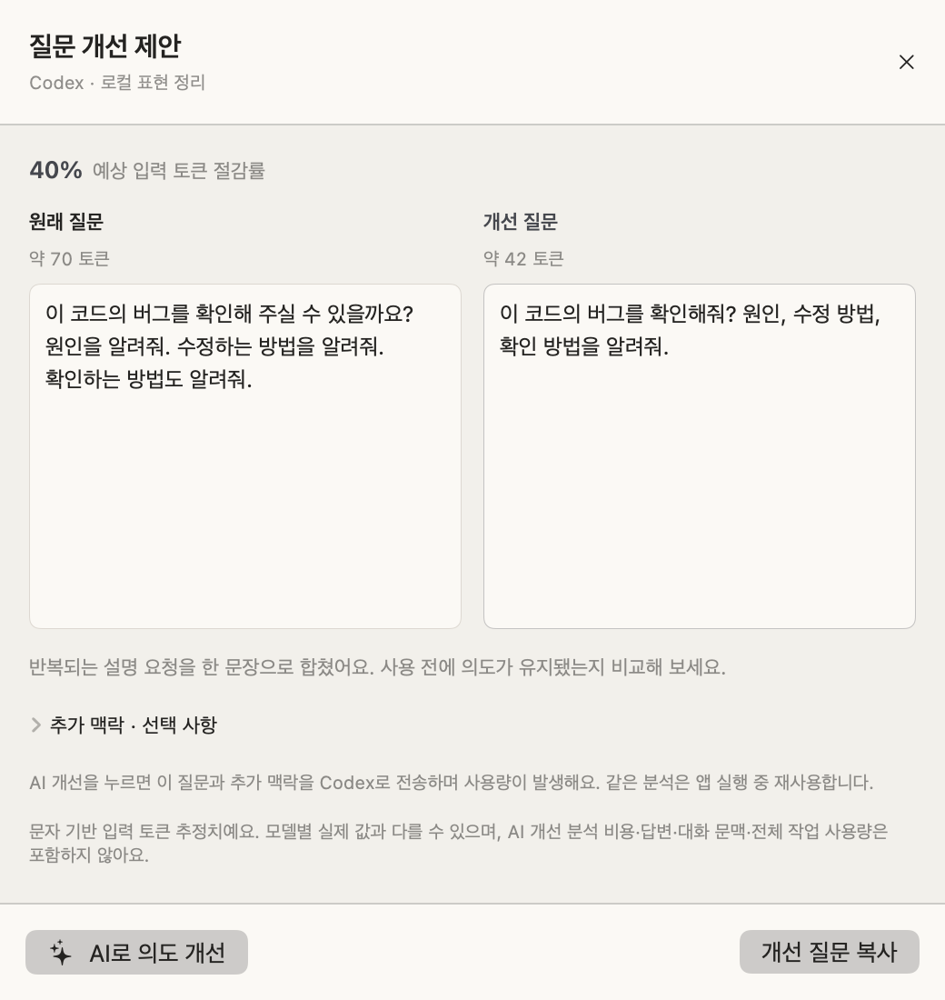

1. **설정 > 위젯 > 위젯 항목과 순서**에서 **질문 개선 제안**을 켭니다. 위젯에서 최근 질문을 선택하거나 직접 입력합니다.
2. **원래 질문**과 **개선 질문**을 나란히 읽고 의도가 유지됐는지 확인합니다. 예시의 약 70토큰과 42토큰을 비교하면 예상 입력 토큰 절감률은 40%입니다.
3. **개선 질문 복사**를 눌러 클립보드로 옮깁니다. 더 구체적으로 다듬으려면 **추가 맥락**을 적고 **AI로 의도 개선**을 누릅니다. 이때 질문과 추가 맥락을 Codex로 보내므로 계정 사용량이 발생할 수 있습니다.

이미지를 누르면 확대해서 볼 수 있습니다. [스크린샷 파일 모아 보기](./screenshots)


## 설치

### macOS

1. [DMG][mac-dmg]를 열고 AI usage를 **응용 프로그램** 폴더에 옮깁니다. [ZIP][mac-zip]을 받았다면 압축을 풀어 `AI usage.app`을 같은 폴더로 옮깁니다.
2. 응용 프로그램 폴더에서 AI usage를 실행하고, 화면 상단의 **메뉴 막대 아이콘**을 누릅니다.
3. 자동 실행을 원하면 **시스템 설정 > 일반 > 로그인 항목 및 확장 프로그램 > 로그인 시 열기**에 AI usage를 추가합니다. 다음 로그인부터 실행됩니다.

이 배포판은 ad-hoc 서명된 미공증 빌드입니다. 처음 열 때 macOS가 안내를 표시하면 아래 체크섬으로 받은 파일을 확인하고 Apple의 안내를 참고하세요. [Apple의 앱 실행 안내](https://support.apple.com/ko-kr/102445)

### Windows

1. [Windows x64 ZIP][win-zip] 전체를 원하는 폴더에 압축 해제합니다. `AI usage.exe`와 함께 풀린 DLL을 같은 폴더에 둡니다.
2. `AI usage.exe`를 실행하고 작업 표시줄의 **알림 영역**에서 AI usage 아이콘을 누릅니다. 아이콘이 보이지 않으면 숨겨진 아이콘 목록을 펼칩니다.
3. Claude 로그인 창이 열리지 않고 WebView2가 필요한 경우 Microsoft의 Evergreen Runtime을 설치합니다. .NET 런타임은 배포 ZIP에 포함되어 있습니다. [Microsoft WebView2 Runtime](https://developer.microsoft.com/en-us/microsoft-edge/webview2/)
4. 자동 실행을 원하면 앱 설정에서 **Windows 시작 시 실행**을 켭니다. 설치 폴더를 옮긴 경우 새 위치에서 실행하고 설정을 확인합니다.

Windows ZIP은 Authenticode 서명이 없는 교차 빌드입니다. 실제 Windows 실행 검증 범위는 아래 [배포 검증](#배포-검증)을 참고하세요.

### 체크섬 확인

릴리스에서 설치 파일과 해당 `.sha256` 파일을 같은 폴더에 받습니다. 터미널 또는 PowerShell에서 그 폴더로 이동한 뒤 아래 명령을 실행합니다. [릴리스 및 체크섬][release]

**macOS 터미널**

```sh
shasum -a 256 -c AI-usage-2.2.0.dmg.sha256
```

ZIP을 받았다면 명령의 파일명을 `AI-usage-2.2.0-macOS.zip.sha256`으로 바꿉니다. `OK`가 표시되면 파일이 체크섬과 일치합니다.

**Windows PowerShell**

```powershell
Get-FileHash .\AI-usage-Windows-2.2.0-win-x64.zip -Algorithm SHA256
```

`Hash` 값이 릴리스의 `AI-usage-Windows-2.2.0-win-x64.zip.sha256`에 적힌 값과 일치하는지 확인합니다.

### 업데이트

새 버전을 설치할 때는 실행 중인 AI usage를 먼저 종료합니다. macOS는 응용 프로그램 폴더의 앱을 새 파일로 교체합니다. Windows는 새 ZIP 전체를 같은 위치에 덮어쓰기보다 새 폴더에 풀어 실행하고, 시작 프로그램 설정을 사용한다면 경로를 확인합니다. 운영체제별 설정과 사용량 기록은 설치 파일과 별도로 저장됩니다.

## 계정 연결

### Codex

1. 이 컴퓨터의 **Codex 앱 또는 공식 CLI**에서 사용량을 보고 싶은 ChatGPT 계정으로 로그인합니다.
2. AI usage 팝업을 열고 **새로고침**을 누른 뒤 **Codex** 상세를 확인합니다.
3. Windows가 Codex를 자동으로 찾지 못하면 설정에서 실제 `codex.exe` 경로를 지정합니다. 설치 위치나 실행 파일 경로를 바꿨다면 다시 확인합니다.

AI usage는 설치된 Codex의 로컬 `app-server`를 통해 계정의 한도와 사용량을 읽습니다. 이 연결에는 AI usage에 별도 API 키를 입력하는 과정이 없습니다.

### Claude

1. 팝업에서 **Claude** 상세를 엽니다.
2. **로그인**을 눌러 Claude 로그인 화면에서 인증합니다.
3. 앱으로 돌아와 새로고침합니다. 여러 Claude 조직에 속해 있다면 현재 표시된 조직과 사용하려는 계정을 확인합니다.

한 서비스만 연결해도 해당 서비스의 수치를 볼 수 있습니다. 플랜이나 서버 응답에 따라 일부 한도 또는 주간 사용 내역이 없을 수 있습니다.

## 사용법

### 한도와 초기화 시간 읽기

- **사용량**은 이미 소진한 한도이고, **잔여량**은 남아 있는 한도입니다. 예를 들어 사용량이 38%이면 같은 한도의 잔여량은 62%입니다.
- 5시간과 7일은 서로 다른 한도입니다. 각각의 수치와 초기화 시간을 함께 확인합니다.
- Claude 상세에서 **모델별·추가 한도**와 **주간 사용 내역**을 펼칠 수 있습니다. 주간 내역의 비중은 전체 주간 사용량의 구성입니다. 예를 들어 Claude Code 비중이 80%라면 주간 사용 중 80%가 Claude Code에서 발생했다는 뜻입니다.
- 표시값이 비어 있거나 `—`이면 연결과 새로고침을 확인합니다. 계정에서 제공하지 않는 한도는 0%로 해석하지 않습니다.

### 팝업과 위젯 꾸미기

1. **팝업 디자인**은 메뉴 막대·트레이 팝업 상단에서 고릅니다. 설정 화면에도 같은 디자인이 적용됩니다.
2. 팝업의 **위젯 켜기**로 위젯을 연 뒤 **위젯 편집**에서 위젯 디자인과 배치를 고릅니다.
3. 사용량 그래프는 각 화면에서 **막대형** 또는 **원형**을 따로 설정합니다.
4. 위젯 편집에서 보고 싶은 항목을 선택하고 순서를 바꿉니다. 위젯의 상단 손잡이로 이동하고, 닫기 버튼으로 숨깁니다.

| 디자인 | 화면 표현 |
| --- | --- |
| 기본 | 서비스별 한도를 간결한 표로 표시 |
| Liquid Glass | 반투명 카드와 색상별 그래프 |
| Material 3 Expressive | 둥근 강조 영역과 부드러운 진행 표시 |
| Bento Grid | 한도를 읽기 쉬운 타일로 묶어 표시 |
| Structural UI | 얇은 구분선으로 한도와 수치를 정렬 |

세로·가로·전환·분리 배치로 위젯의 위치와 밀도를 조절할 수 있습니다. 작업을 위주로 보고 싶다면 **작업 중심** 배치를 선택합니다.

### 펫·알림·작업 목록

- **펫** 설정에서 Codex 펫이나 내장 캐릭터를 선택하고 애니메이션을 조절합니다. 사용자 펫은 이 컴퓨터의 Codex 설정에서 읽습니다.
- **알림**에서 한도 임박 기준과 초기화 알림을 설정합니다. 운영체제에서도 AI usage 알림이 허용되어 있어야 합니다.
- **작업 목록**은 이 컴퓨터의 Codex·Claude Code 로그에서 지원되는 작업을 표시합니다. 항목에서 연결되는 앱이나 세션을 열 수 있으며, 앱 목록에서 항목을 치워도 원래 대화나 로그 파일은 삭제되지 않습니다.
- macOS의 **질문 개선 제안**은 질문의 원문과 개선안을 비교할 수 있습니다. **AI로 의도 개선**을 선택하면 질문과 입력한 추가 맥락이 Codex로 전송되고 계정 사용량이 발생할 수 있습니다.

### 토큰 수·비용·추이

| 항목 | 읽는 방법 |
| --- | --- |
| 오늘 토큰 수 | 팝업의 `Σ`에서 서비스별 집계를 확인합니다. 계정 또는 기기에서 확인된 데이터에 따라 값이 일부만 표시될 수 있습니다. |
| 오늘 비용 추정 | 팝업 상단의 오늘 비용 배지를 누르면 서비스별 추정치를 볼 수 있습니다. 이 기기에서 확인할 수 있는 로컬 사용량을 표준 API 요율로 환산합니다. 구독·API 청구 확인에는 각 서비스의 청구 화면을 사용하세요. |
| 사용량 추이 | 설정에서 **사용량 기록**을 켜면 이 기기에 수치가 저장됩니다. 팝업의 그래프 버튼에서 기간과 서비스를 바꿔 확인할 수 있습니다. |

## 데이터와 개인정보

| 데이터 | 출처 및 저장 방식 |
| --- | --- |
| Codex 사용량 한도 | 설치된 Codex의 `app-server`에서 현재 로그인한 계정의 한도와 일별 통계를 읽습니다. |
| Claude 사용량 한도 | Claude 로그인 세션으로 계정의 사용량을 읽습니다. macOS는 세션을 Keychain에 저장하며, Windows는 현재 사용자 범위 DPAPI를 사용합니다. |
| 작업 상태·로컬 토큰 | 이 기기에 있는 Codex·Claude Code의 로컬 기록을 사용합니다. 같은 계정이라도 다른 기기나 클라우드 세션 기록은 로컬 비용에 포함되지 않을 수 있습니다. |
| 사용량 추이 | 사용자가 기록을 켜면 사용량 수치를 기기에 최대 14일 보관합니다. 설정에서 기록을 지울 수 있습니다. |

Claude 연동은 문서화되지 않은 웹 사용량 경로에 의존합니다. 서비스 쪽 변경이나 계정별 응답 차이로 연결·표시가 달라질 수 있습니다.

## 문제 해결

| 증상 | 확인할 것 |
| --- | --- |
| **Codex 한도에 수치가 안 보임** | 같은 컴퓨터의 Codex 앱·CLI에 로그인됐는지 확인한 뒤 팝업을 새로고침합니다. Windows에서는 실행 파일 경로도 확인합니다. |
| **Claude 데이터나 주간 내역이 없음** | Claude 상세에서 재로그인하고 새로고침합니다. 주간 내역은 계정에서 제공할 때만 표시됩니다. |
| **Windows Claude 로그인 창이 비어 있음** | WebView2 Evergreen Runtime 설치 여부를 확인합니다. [Microsoft WebView2 Runtime](https://developer.microsoft.com/en-us/microsoft-edge/webview2/) |
| **위젯이 안 보임** | 메뉴 막대·트레이 팝업에서 위젯을 켭니다. 분리 배치라면 Claude·Codex 위젯의 표시 설정을 확인합니다. |
| **앱 실행 전 개발자 경고가 나옴** | 이 저장소에서 받은 파일인지 먼저 확인하고 SHA-256을 대조합니다. Mac 배포판은 미공증이며 Windows 배포판에는 Authenticode 서명이 없습니다. [Apple의 앱 실행 안내](https://support.apple.com/ko-kr/102445) |
| **초기화 알림이 오지 않음** | 앱의 알림 설정과 운영체제의 AI usage 알림 권한을 확인합니다. 초기화 시각은 서비스가 제공한 데이터에 따라 표시됩니다. |

문제를 제보할 때는 앱 버전·빌드, 운영체제, 사용한 기능, 재현 순서를 적어주세요. 스크린샷이나 로그에 계정 정보, 세션 값, 대화 내용이 들어 있는지 확인한 뒤 올려주세요. [문제 제보](https://github.com/jiwoo-0929/AI-usage/issues)

## 배포 검증

| 항목 | 2.2.0 빌드 47에서 확인한 범위 |
| --- | --- |
| macOS | Apple Silicon·Intel 공용 바이너리. Mac 설치·실행, 호환성 검사 272개, 위젯 검사 43개 통과 |
| Windows | 파일 버전 `2.2.0.47`. Mac에서 Windows x64로 교차 빌드, Core 테스트 356개 통과. WPF·시작 프로그램 코드 컴파일 확인. Windows에서 실제 실행하는 검증은 미실시 |
| 공개 파일 | GitHub Release에 첨부한 DMG·ZIP 세 개의 크기와 SHA-256이 배포본과 일치 |

변경 내용과 설치 파일은 릴리스 페이지에서 확인할 수 있습니다. [AI usage 2.2.0 릴리스][release]

## 원본 프로젝트와 라이선스

AI usage는 Jaewoo Lee의 **ClaudeUsage**를 바탕으로 만든 배포판입니다. 원본 프로젝트와 MIT 라이선스의 저작권 고지는 아래에서 확인할 수 있습니다. [원본 ClaudeUsage](https://github.com/jaewoo4200/ClaudeUsage) · [MIT 라이선스 및 저작권 고지](LICENSE)

[release]: https://github.com/jiwoo-0929/AI-usage/releases/tag/ai-usage-v2.2.0
[mac-dmg]: https://github.com/jiwoo-0929/AI-usage/releases/download/ai-usage-v2.2.0/AI-usage-2.2.0.dmg
[mac-zip]: https://github.com/jiwoo-0929/AI-usage/releases/download/ai-usage-v2.2.0/AI-usage-2.2.0-macOS.zip
[win-zip]: https://github.com/jiwoo-0929/AI-usage/releases/download/ai-usage-v2.2.0/AI-usage-Windows-2.2.0-win-x64.zip
